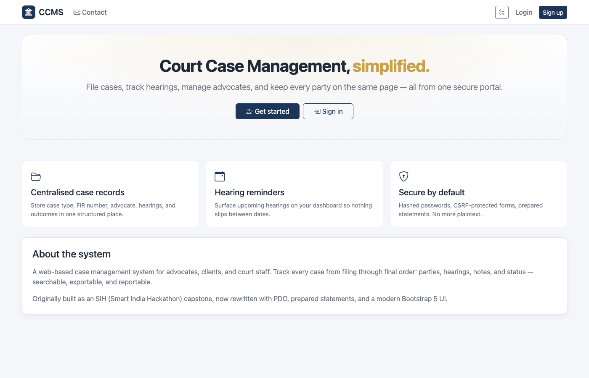
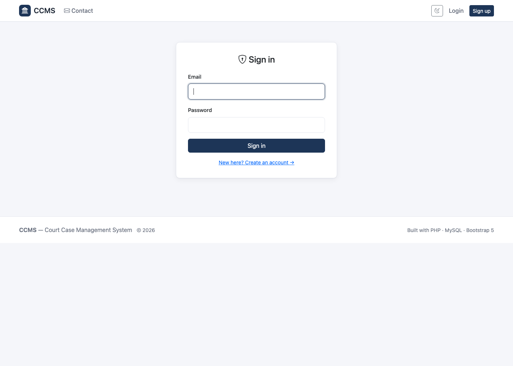
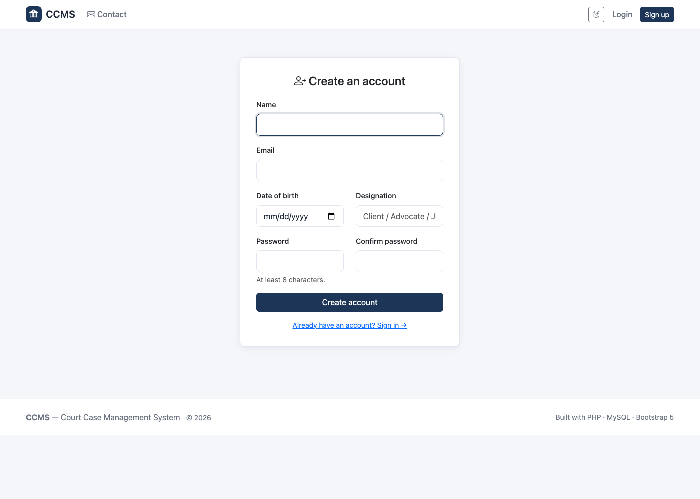

# Court Case Management System (CCMS)


A full-stack web application for managing court cases end-to-end: filing, hearings, advocates,
notes, and outcomes. Originally built as a Smart India Hackathon (SIH) capstone, now rewritten
with a modern stack: **PDO + prepared statements, password hashing, CSRF protection, Bootstrap 5,
dark mode, and a proper relational schema.**

## Highlights

- **Authentication** — Sign up / sign in with `password_hash` + `password_verify` (no MD5).
- **CSRF protection** — All forms include a token validated on POST.
- **PDO prepared statements** — SQL injection surface eliminated.
- **Dashboard** — Live counts (Total / Open / In progress / Closed) and upcoming hearings widget.
- **Cases CRUD** — File, view, edit, delete, with breadcrumbs and validation.
- **Search & filter** — Full-text style search + status filter + multi-column sort + pagination.
- **Status workflow** — `open → in_progress → adjourned → closed | dismissed | won | lost`.
- **Priority** — Low / Medium / High / Urgent, surfaced visually in lists.
- **Notes & timeline** — Threaded notes per case with timestamps and authors.
- **Hearing reminders** — Dashboard surfaces hearings in the next 14 days with day-relative labels.
- **Contact form** — Persisted to `contact_messages` for back-office triage.
- **Dark mode** — Full theme toggle with `localStorage` persistence.
- **Modern UI** — Bootstrap 5 + Bootstrap Icons, custom design tokens, responsive.
- **JSON API** — `/api/stats.php` for the current user's case counts.
- **Environment config** — `.env` driven, no hardcoded credentials.

## Screenshots

| Landing | Sign in | Sign up |
|---|---|---|
|  |  |  |

_(More screenshots — dashboard, case list, case detail, dark mode — to be added once a live demo deployment is available.)_

## Tech Stack

| Layer    | Tech                                               |
|----------|----------------------------------------------------|
| Backend  | PHP 7.4+ (PDO, MySQLi-free)                        |
| Database | MySQL 5.7+ / MariaDB 10.3+, InnoDB, FULLTEXT index |
| Frontend | Bootstrap 5.3, Bootstrap Icons, vanilla JS         |
| Sessions | PHP native, hardened cookies (HttpOnly, SameSite)  |

## Project Structure

```
.
├── PHP/
│   ├── config/
│   │   ├── env.php              # .env loader
│   │   ├── db.php               # PDO singleton
│   │   └── auth.php             # session, CSRF, helpers
│   ├── includes/
│   │   ├── header.php           # shared <head> + navbar
│   │   ├── footer.php           # shared <footer> + JS
│   │   ├── errors.php           # validation error renderer
│   │   └── case_form_fields.php # shared add/edit form
│   ├── assets/
│   │   ├── css/styles.css       # design tokens + components
│   │   └── js/app.js            # theme toggle, confirm
│   ├── api/
│   │   └── stats.php            # JSON case stats
│   ├── index.php                # landing
│   ├── login.php  signup.php  logout.php  forgotpass.php
│   ├── dashboard.php            # stats + upcoming + recent
│   ├── cases.php                # list, search, filter, paginate
│   ├── case_view.php            # detail + notes + status
│   ├── case_edit.php  case_delete.php
│   ├── addcase.php              # file new case
│   ├── contact.php              # contact form (stored)
│   └── thankyou.php  server.php # legacy compatibility shims
├── Image/                       # screenshots, logo, presentation
├── schema.sql                   # full DB schema
├── .env.example                 # config template
└── SETUP.md                     # local install guide
```

## Quick Start

```bash
git clone https://github.com/Sanjays2402/Court-Case-Management.git
cd Court-Case-Management
cp .env.example .env             # then edit DB creds
mysql -u root -p < schema.sql
php -S localhost:8080 -t PHP     # dev server
```

Visit <http://localhost:8080>. See [SETUP.md](SETUP.md) for production deployment notes
(Apache / Nginx, .htaccess, HTTPS hardening).

## Database Schema

Five tables:

- `users` — accounts, roles (`client`, `advocate`, `admin`), hashed passwords.
- `cases` — case records with FK to `users`, FULLTEXT index for search.
- `hearings` — chronological hearing records (FK to `cases`).
- `case_notes` — free-form notes (FK to `cases` and `users`).
- `contact_messages` — contact-form submissions.

Status enum: `open`, `in_progress`, `adjourned`, `closed`, `dismissed`, `won`, `lost`.
Priority enum: `low`, `medium`, `high`, `urgent`.

See [`schema.sql`](schema.sql) for the full DDL.

## Security

- Passwords hashed with `password_hash` (bcrypt by default).
- All SQL via PDO prepared statements — no string interpolation.
- CSRF tokens generated per session and validated on every POST.
- Session cookies set with `HttpOnly` + `SameSite=Lax` (and `Secure` on HTTPS).
- All output escaped via `ccms_e()` (`htmlspecialchars`).
- Authorization checks on every case-scoped action (`WHERE user_id = ?`).

## Roadmap

- [ ] Email-based password reset (token + expiry table).
- [ ] Document upload per case (S3 / local with size limits).
- [ ] Admin panel for managing users + reading contact messages.
- [ ] Calendar view for hearings.
- [ ] CSV export of cases and hearings.
- [ ] Email reminders for hearings within 24/48 hours.
- [ ] Two-factor authentication.

## Author

**Sanjay Santhanam** — [@Sanjays2402](https://github.com/Sanjays2402)

## License

MIT — see [LICENSE](LICENSE) (add one if missing).

---

⭐ Star this repo if you found it useful!

## Terms & Disclaimer

By using this project you agree to the following.

- **No warranty.** This software is provided "as is", without warranty of any kind, express or implied, including merchantability, fitness for a particular purpose, and non-infringement.
- **No liability.** To the maximum extent permitted by law, the author and contributors are not liable for any claim, loss, or damage (direct, indirect, incidental, or consequential, including lost data or profits) arising from its use.
- **Your responsibility.** You use it at your own risk and are responsible for complying with the laws that apply to you.
- **Your data.** Keep backups; data loss is possible. If you process other people's personal information, you are responsible for complying with privacy laws such as US state privacy laws (e.g. CCPA), PIPEDA and Quebec's Law 25 (Canada), and the Digital Personal Data Protection Act, 2023 (India).
- **Not legal advice.** This is a software demo, not a law-practice tool or legal service. It does not calculate legal deadlines and must not be relied on for court dates or filings. Do not store real case data in it.
- **Third parties.** Names, logos, APIs, and services of others belong to their owners and are used for identification only; no affiliation or endorsement is implied.
- **Your statutory rights.** Nothing here limits rights that cannot be waived by agreement, including under consumer-protection laws in the USA, Canada (including Quebec), and India (Consumer Protection Act, 2019).
- **License.** Use, copying, and distribution are governed by the [LICENSE](LICENSE) file; if anything here conflicts with it, the license controls.

## Content, Assets & Fair Use

- **Original work.** Unless noted otherwise (including below), the code, text, design, and images in this repository were created by the author.
- **Libraries, fonts, and icons.** Third-party libraries, fonts (for example Google Fonts), and icon sets belong to their creators and are used under their own licenses; see the dependency manifests and each source for terms.
- **Logos, brands, and screenshots.** Third-party names, logos, and screenshots appear only to identify or describe their products (nominative use). They remain the property of their owners and do not imply affiliation or endorsement.
- **Ideas and inspiration.** Where this project is inspired by another product, game, or idea, it is an independent implementation. It borrows only general ideas, mechanics, or styles, which are not anyone's exclusive property, and is meant to contain no third-party code or artwork used without permission.
- **Fair use and fair dealing.** Any third-party material is used in limited ways for purposes such as education, research, review, commentary, or identification, relying on fair use in the USA (17 U.S.C. § 107), fair dealing in Canada (Copyright Act, ss. 29–29.2), and fair dealing in India (Copyright Act, 1957, s. 52), where they apply.
- **Concerns and takedown requests.** If you own rights in something here and believe it is used improperly, [open an issue](https://github.com/Sanjays2402/Court-Case-Management/issues) or contact the author through their GitHub profile with a link to the material and your claim. It will be reviewed promptly and credited, changed, or removed as appropriate. You may also use GitHub's DMCA process.
- **Contributions.** By contributing, you confirm you have the right to submit your contribution and agree it is licensed under this repository's license.
